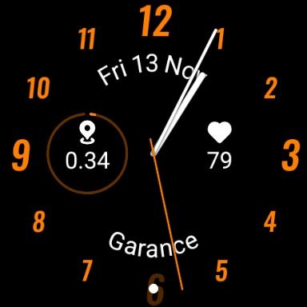

# SimpleWatchFace 4

A very simple (_« yet elegant™ »_) round watchface for Wear OS (formerly known as Android Wear).

It supports up to 4 complications.  The top and bottom complications can be small or big, while the left and right ones are small.

This is a port of [SimpleWatchFace 3](https://github.com/BoD/SimpleWatchFace3) to the [Watch Face Format](https://developer.android.com/training/wearables/wff).

